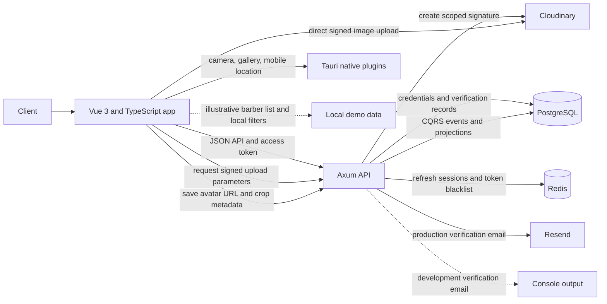
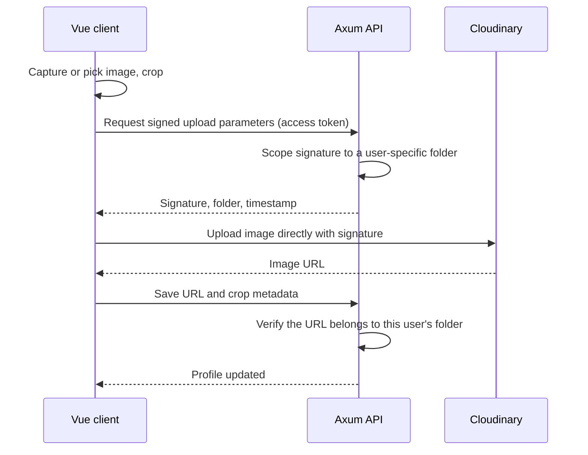

# Barberaus

A cross-platform grooming-discovery app: clients build a profile around the haircut they want, then use it to find barbers. Rust API, Vue 3 client, Tauri 2 shell for desktop and mobile.

> **Status: early-stage.** Authentication, email verification, sessions, and avatar upload work end to end. Barber discovery is illustrative UI only, and booking is not built. See [Current status](#current-status) for the exact state of each capability.

## Contents

- [Overview](#overview)

- [Current status](#current-status)

- [Architecture](#architecture)

- [Key engineering decisions](#key-engineering-decisions)

- [Technology stack](#technology-stack)

- [Repository structure](#repository-structure)

- [Getting started](#getting-started)

- [Testing](#testing)

- [Known issues](#known-issues)

- [Roadmap](#roadmap)

- [Documentation](#documentation)

## Overview

Clients usually explain a haircut with words or reference photos, then search separately for a barber who offers it. Barberaus combines both steps: a client creates a profile, collects haircut inspiration, sets a search area, and discovers barbers.

- **Intended users:** clients looking for grooming services. Barbers and shops come in a later stage.

- **Current scope:** client onboarding and account experience.

- **Out of scope today:** this is not a finished marketplace or booking platform.

## Current status

| Capability | Status | Details |
|---|---|---|
| Registration and authentication | Integrated | Signup, login, and email verification are connected to the Rust API. Passwords are hashed with Argon2. |
| Email verification | Integrated, with limits | The code is stored as a hash with an expiry. Delivery uses a console adapter in development and Resend in production. The client has no resend-code control. |
| Session management | Integrated | Short-lived JWT access tokens and Redis-backed refresh sessions support login, refresh, and logout. |
| Client profile and avatar | Partial | An authenticated client can upload an avatar and save its URL and crop metadata. Profile creation and event persistence exist. The client does not yet load saved profile data or sync its other onboarding answers. |
| Haircut-style preferences | Backend only | The server exposes a catalog and a preferences endpoint. The UI uses a local catalog and keeps selections in client state. |
| Mobile media and location | Partial | Tauri camera and gallery plugins feed the avatar workflow. Mobile geolocation reads coordinates, and a custom plugin opens platform settings. Location is not persisted or used in server search. |
| Barber discovery | Illustrative UI | Cards, ratings, distances, availability, filters, and follow toggles use local demo data. The screen labels the results as illustrative. |
| Live search and follow persistence | Not connected | No barber-list route is registered, and the follow handler is not mounted in the router. |
| Booking, appointments, shop management | Deferred | Some domain and membership scaffolding exists. No user workflow is connected. |

A working discovery screen is not evidence of live search: it filters local sample data.

## Architecture



The API is layered: HTTP handlers call application services, which coordinate domain commands and persistence or provider adapters. CQRS event streams and JSONB read views share PostgreSQL. Redis holds refresh-session metadata and access-token blacklist entries.

### Avatar upload flow

The image bytes never pass through the API. The API only signs the upload and verifies the result.




## Key engineering decisions

| Decision | Reason | Trade-off |
|---|---|---|
| Direct, signed uploads to Cloudinary | Keeps image traffic off the API and limits what a client can write. | Ownership must be checked server-side after upload, which the API does. |
| Short-lived JWT plus Redis refresh sessions | Access tokens stay stateless. Refresh sessions can be revoked, and a blacklist covers logout. | Adds Redis as a required dependency. |
| Argon2 password hashing, hashed and expiring verification codes | No plaintext secrets at rest. | Slightly higher login cost. |
| Event-sourced client profile (`cqrs-es`) with JSONB projections | Full history of profile changes, with a read model shaped for the UI. | Projection logic is the most complex part of the backend. The one failing test is in this layer (see [Known issues](#known-issues)). |
| Fetch in the browser, Tauri HTTP plugin in the native shell | Same API client on web and native. | Two transports to keep behaviour-compatible. |

## Technology stack

| Responsibility | Technologies |
|---|---|
| Backend HTTP and async runtime | Rust (2024 edition), Axum 0.8, Tokio |
| Application and domain | Application services, domain aggregates, `async-trait`, `thiserror`, explicit DTO and domain validation |
| Persistence | PostgreSQL with PostGIS, SQLx 0.8, `cqrs-es` 0.5, `postgres-es` 0.5 |
| Session infrastructure | Redis (`deadpool-redis`), `jsonwebtoken`, Argon2 |
| Client | Vue 3, TypeScript, Pinia, Vue Router, Vue I18n |
| Forms and styling | vee-validate, Yup, Tailwind CSS 4 (Vite plugin) |
| Desktop and mobile shell | Tauri 2 with dialog, filesystem, HTTP, camera, and geolocation plugins |
| External services | Cloudinary (signed uploads), Resend (production email) |

Nominatim is included in the root Docker Compose stack and is configured to import the Algeria OpenStreetMap dataset. Its HTTP API is exposed at `http://localhost:8081`. The Barberaus API does not currently call Nominatim, and location is not yet persisted or used in server-side discovery.

## Repository structure

```text
.
├── .git-blame-ignore-revs
├── README.md
├── client/
│   ├── README.md                       # Frontend and Tauri client guide
│   ├── package.json                   # Vue, TypeScript, and Vite scripts and dependencies
│   ├── vite.config.ts
│   ├── public/                         # Static assets
│   ├── src/
│   │   ├── components/
│   │   │   ├── auth/
│   │   │   ├── layout/
│   │   │   └── onboarding/
│   │   ├── composables/
│   │   │   └── discovery/
│   │   ├── data/                       # Local catalogs and illustrative discovery data
│   │   ├── i18n/
│   │   │   └── locales/
│   │   ├── router/
│   │   ├── stores/                     # Pinia state
│   │   ├── transport/                  # API client and request handling
│   │   ├── types/
│   │   ├── utils/
│   │   ├── views/
│   │   │   ├── auth/
│   │   │   ├── barber/
│   │   │   └── client/
│   │   ├── App.vue
│   │   ├── main.ts
│   │   └── style.css
│   ├── src-tauri/                      # Tauri app configuration and native shell
│   │   ├── capabilities/               # Plugin permissions
│   │   ├── gen/android/                # Android project
│   │   ├── icons/
│   │   ├── schemas/
│   │   └── src/
│   └── tauri-plugin-location-settings/ # Local Android/iOS location-settings plugin
│       ├── android/
│       ├── ios/
│       ├── permissions/
│       ├── src/
│       └── guest-js/
├── postman/
│   ├── Barberaus API.postman_collection.json
│   └── Barberaus Auth.postman_environment.json
└── server/
    ├── README.md                       # Backend architecture and API guide
    ├── .env.example                    # Backend and Compose environment template
    ├── docker-compose.yml              # PostGIS, Redis, and Nominatim infrastructure
    ├── Cargo.toml
    ├── migrations/                     # Ordered PostgreSQL schema and index migrations
    └── src/
        ├── application/
        │   ├── ports/
        │   ├── segas/
        │   └── services/
        ├── domain/
        │   ├── appointment/
        │   ├── shop/
        │   ├── user/
        │   └── views/
        ├── infrastructure/
        │   ├── nominatim/
        │   │   └── .env.example        # Nominatim import and runtime configuration
        │   ├── persistence/
        │   └── redis/
        ├── projections/
        │   ├── custom_queries/
        │   ├── sagas/
        │   └── view_repo/
        ├── transport/
        │   ├── dto/
        │   ├── http/
        │   ├── middlewares/
        │   └── ws/
        ├── config.rs
        ├── cqrs.rs
        ├── state.rs
        └── main.rs
```

## Getting started

### Prerequisites

- Docker Engine with Docker Compose v2 (Docker Desktop includes both on Windows and macOS)

- Rust toolchain that supports the 2024 edition

- Node.js and npm

- Cloudinary credentials (required for server startup and avatar upload)

- A Resend API key when `ENV=production`

- Native targets: the relevant Tauri toolchain. Android needs the Android SDK; iOS needs macOS and Xcode.

### Infrastructure

[`server/docker-compose.yml`](server/docker-compose.yml) starts the infrastructure used by the project:

- **PostGIS:** the application PostgreSQL database.
- **Redis:** refresh-session and token-blacklist infrastructure.
- **Nominatim:** a separate geocoding service configured to download and import the Algeria OpenStreetMap dataset. It runs its own PostgreSQL instance and uses a volume separate from the application database.

The default host endpoints are:

| Service | Endpoint |
|---|---|
| PostGIS | `localhost:5432` |
| Redis | `127.0.0.1:6379` |
| Nominatim HTTP API | `http://localhost:8081` |

The first Nominatim startup downloads and imports the configured Algeria dataset. This initial import can take considerable time and requires sufficient disk space and memory. Wait for the import to finish before relying on the Nominatim API. You can inspect startup output with `docker compose --project-directory . -f server/docker-compose.yml --env-file server/.env logs -f nominatim`.


### Backend

1. Create the backend environment file from its template:

   ```sh
   cp server/.env.example server/.env
   ```
   On PowerShell:
   ```powershell
   Copy-Item server/.env.example server/.env
   ```
   Set the variables below. Keep the actual `.env` file out of version control.
   | Variable | Notes |
   |---|---|
   | `ENV` | `development` or `production` |
   | `JWT_SECRET` | At least 32 bytes |
   | `DATABASE_URL` | PostgreSQL connection string; use the PostGIS host port configured below |
   | `REDIS_URL` | Redis connection string; use the Redis host port configured below |
   | `POSTGRES_DB` | Required by Docker Compose; application database name |
   | `POSTGRES_USER` | Required by Docker Compose; application database user |
   | `POSTGRES_PASSWORD` | Required by Docker Compose; application database password |
   | `POSTGRES_PORT` | Optional host port; defaults to `5432` |
   | `REDIS_PORT` | Optional host port; defaults to `6379` |
   | `FROM_EMAIL` | Required in both environments |
   | Cloudinary variables | Required in both environments |
   | `RESEND_API_KEY` | Required only when `ENV=production` |
   Ensure `POSTGRES_DB`, `POSTGRES_USER`, and `POSTGRES_PASSWORD` are included in the committed `server/.env.example`; Compose requires them when starting a fresh installation. `DATABASE_URL` must use the same database name, username, and password. When the backend runs directly on the host as described below, connect through `localhost` and the configured host port.
2. Create the Nominatim environment file from its template:
   ```sh
   cp server/src/infrastructure/nominatim/.env.example server/src/infrastructure/nominatim/.env
   ```
   On PowerShell:
   ```powershell
   Copy-Item server/src/infrastructure/nominatim/.env.example server/src/infrastructure/nominatim/.env
   ```
   Replace `NOMINATIM_PASSWORD` with a strong password. Keep this actual `.env` file out of version control.
   | Variable | Purpose |
   |---|---|
   | `NOMINATIM_PASSWORD` | Password for Nominatim's bundled PostgreSQL instance; replace the template value |
   | `PBF_URL` | Algeria OpenStreetMap PBF dataset downloaded for the initial import |
   | `REPLICATION_URL` | Source URL for Algeria OSM updates |
   | `IMPORT_STYLE` | Import profile; the template uses `address` |
   | `IMPORT_WIKIPEDIA` | Whether to import Wikipedia data; the template uses `false` |
   | `THREADS` | Number of import threads; the template uses `2` |
   | `GUNICORN_WORKERS` | Nominatim API worker count; the template uses `1` |
   | `WARMUP_ON_STARTUP` | Whether to warm up the API on startup; the template uses `false` |
   | `UPDATE_MODE` | Replication mode; the template uses `none` |
   | `POSTGRES_SHARED_BUFFERS` | Memory allocated to PostgreSQL shared buffers |
   | `POSTGRES_MAINTENANCE_WORK_MEM` | Memory available to maintenance operations |
   | `POSTGRES_AUTOVACUUM_WORK_MEM` | Memory available to autovacuum operations |
   | `POSTGRES_WORK_MEM` | Memory available to query operations |
   | `POSTGRES_EFFECTIVE_CACHE_SIZE` | PostgreSQL planner's estimate of available cache |
   | `POSTGRES_MAX_CONNECTIONS` | Maximum PostgreSQL connections |
   The template's `UPDATE_MODE=none` disables automatic OSM replication updates. The dataset is imported for the initial setup, but it will not automatically stay current unless replication is configured.
3. From the repository root, start the infrastructure:
   ```sh
   docker compose --project-directory . -f server/docker-compose.yml --env-file server/.env up -d
   ```
   The Compose file reads the PostGIS and Redis settings from `server/.env`. It passes the Nominatim-specific `.env` file directly to the Nominatim container. The Nominatim database is separate from the application's PostGIS database.
4. Wait for PostgreSQL and Redis to become ready. The initial Nominatim dataset import can take considerably longer; inspect it with `docker compose --project-directory . -f server/docker-compose.yml --env-file server/.env logs -f nominatim` and wait for initialization to finish before relying on its API.
5. Apply every file in `server/migrations/` in filename order with a PostgreSQL client. The server does **not** run migrations at startup.
6. Start the API:
   ```sh
   cd server
   cargo run
   ```

The API listens on port `8080`. Check it with `GET /health`. In development, verification codes are printed to the console instead of being emailed.

### Client
```sh
cd client
npm install
npm run dev        # Vite dev server on port 5173
```

The client reads `VITE_API_BASE_URL` when it is set. Without it, development uses a built-in desktop URL, or a fixed development-network URL on Android. The production fallback is a placeholder and must not be used as a real deployment URL.
```sh
npm run build                # type-check and create the production bundle
npm run tauri android dev    # Tauri development app (Android)
```

A native build depends on the platform toolchain, and a successful native build has not been established by this repository's documentation.

## Testing
```sh
cd server
cargo test
```

The API collection in `postman/` covers the HTTP surface.

## Known issues

- **One failing test:** a style-preference projection test fails because duplicate style values appear in the projected view. The other 36 server tests pass.

- **Migrations are manual:** there is no migration runner, so schema setup depends on applying SQL files in order.

- **No resend-code control** on the email verification screen.

## Roadmap

The following are not yet implemented in the current scope. They are a committed roadmap. Each milestone is independently deliverable.

1. **Close the onboarding loop:** connect style selection to the backend catalog and preferences endpoint, load saved profile state in the client, add a resend-code control, complete onboarding progression.

2. **Real discovery:** persist location, add a registered barber-list route, implement persistent follow.

3. **Barber and shop side:** profile management, service listings, and, if they remain product goals, appointments and booking.

4. **Operations:** migration automation and a deployment plan.

The backend contains some profile and membership concepts, but they do not amount to a complete marketplace or tenant authorization system.

## Documentation

- [Backend architecture and API guide](server/README.md)

- [Frontend and Tauri client guide](client/README.md)


- API collection: `postman/`
